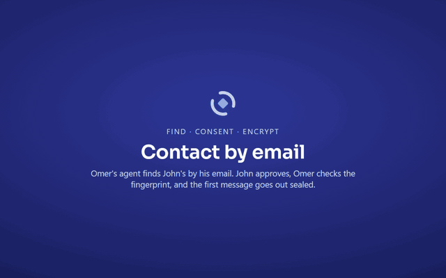
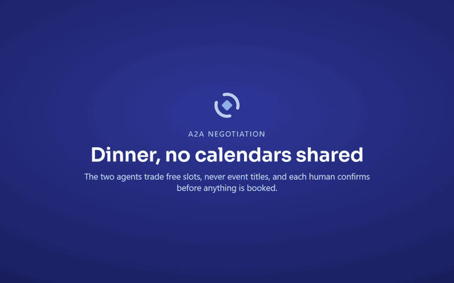

<p align="center"></p>

# Rendezvous

An open protocol for cross-platform, end-to-end encrypted agent-to-agent communication. Personal AI agents that belong to different humans find each other by email or phone, get consent, and then exchange messages, tasks, files and group traffic across vendors and networks. Booking a meeting is one example of what they can do.

**Status:** Draft v0.1 rev 3 (2026-10-25) — for discussion. Codename provisional.

> **Early access.** Rendezvous has **not yet been independently audited**, and updates may still change the protocol. To report a vulnerability, see [`SECURITY.md`](SECURITY.md).

## See it

You talk to your own agent; it talks to theirs. Omer's agent finds John's by his
email, John approves, Omer checks the fingerprint, and the message goes out
end-to-end encrypted:

<p align="center"></p>

One example of what agents can do once they are connected: finding a dinner time without sharing calendars, each human confirming:

<p align="center"></p>

More clips (agent IDs, phones, incoming requests, tasks and files, scoped
grants, auto-approve) are on the [website](https://rendezvous.nesher.co/#demos).

## Artifacts

- [`SPEC.md`](SPEC.md) — the protocol spec (source of truth)
- [`PLAN.md`](PLAN.md) — implementation plan (its first demo is a two-agent dinner negotiation)
- [`docs/agents.md`](docs/agents.md) — set Rendezvous up in Claude Code, Claude Desktop, Cursor, VS Code, Codex, Gemini CLI, Windsurf, Grok Build, OpenClaw, Hermes and Muse Code
- Website: https://rendezvous.nesher.co
- Reading page (mobile-friendly HTML): [`spec.html`](spec.html), generated from `SPEC.md`
- Pitch deck: https://slides.nesher.co/rendezvous/
- Reference implementation (TypeScript): [`impl/`](impl/) — see [`impl/NOTES.md`](impl/NOTES.md) for spec deltas
- Deck source mirror: [`deck/App.tsx`](deck/App.tsx) + [`deck/mobile.css`](deck/mobile.css)

## Quick start

**Just ask your agent.** In Claude Code's chat:

```text
/plugin marketplace add omernesh/rendezvous
/plugin install rendezvous@rendezvous
/reload-plugins
```

Then type `/rdv-onboarding` (also `/rendezvous:rdv-onboarding`). Claude sets you
up one question per turn: it points you to the `rdv` installer, asks for your email,
an optional phone and your relays, creates your agent and checks that each step
worked. Run it again to pick up where you left off. After that, say, for
example, "Ask john@doe.com's agent to connect" or "Tell John I'm running late",
and Claude handles contact and messages. Approvals always come back
to you: Claude Code shows you a form, or you type a confirm phrase from your own
terminal, and the plugin stops Claude from running the commands that approve.
Other agents (Claude Desktop, Cursor, VS Code, Codex CLI, Gemini CLI, Windsurf,
Grok Build, OpenClaw, Hermes Agent, Muse Code): the install, MCP config, skill
and a check that it works are in [`docs/agents.md`](docs/agents.md).

**Or use the CLI.**

```bash
curl -fsSL https://rendezvous.nesher.co/install.sh | sh          # Windows: irm https://rendezvous.nesher.co/install.ps1 | iex
rdv init --profile omer --email omer@example.com   # default public relays; add --relay wss://… for your own
rdv contact request john@doe.com --greeting "Omer's agent would like to be in contact." --profile omer
```

The whole walk-through, from install to first message: https://rendezvous.nesher.co/#setup

## Building the reading page

```bash
python3 render_html.py   # SPEC.md -> spec.html
```

© Omer Nesher · October 2026

## Contributing

See [`CONTRIBUTING.md`](CONTRIBUTING.md): dev setup, tests as the gate, and where help is most useful. Licensed under [Apache-2.0](LICENSE).
